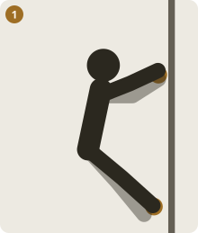
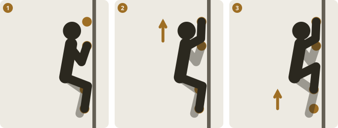
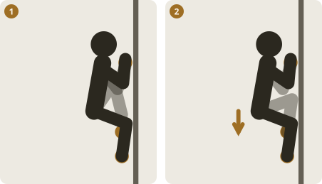
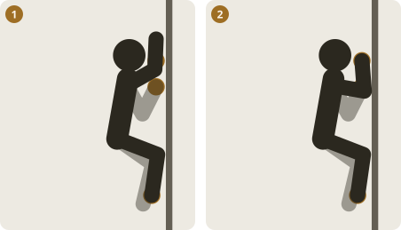
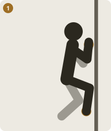
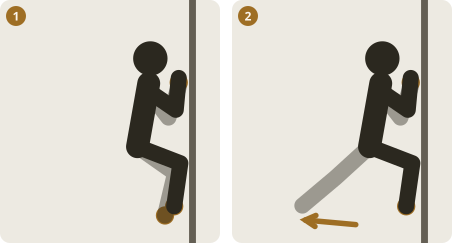
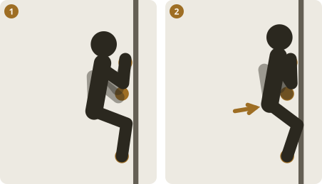

# Drill library

## Coach deck

Technique, warmup and play drills the plans pick from, with a short description of how each is done. 24 drills. Names and descriptions are written for this app. Add your coach's own drills to `COACH_DECK` in `app.js`.

### Sloth & Monkey

*warmup · control* · **3 easy problems, each twice**

Climb each problem once as slowly and statically as you can (sloth), then once with big, swingy dynamic movement (monkey). Notice which style feels less natural and spend a little extra time there.

1. Arms straight, hang off the skeleton and move by turning the hips

### Three-finger sloth

*warmup · control* · **1-2 easy jug problems**

Climb slowly using only the middle three fingers on each hold, hands open and extended, arms as straight as you can keep them. Builds an efficient, relaxed grab.

1. Arms straight, hang off the skeleton and move by turning the hips

### Robot drill

*warmup · control · technique* · **2-3 easy problems**

Move one limb at a time. The rest of the body stays completely still until that limb has settled on the next hold or position, then the next limb goes.

1. Start balanced, all four limbs on holds
2. Move one hand only. Everything else stays still
3. Settled? Now one foot only, to the next hold

### Silent feet

*warmup · footwork* · **3-4 easy problems**

Place every foot so quietly that nobody could hear it. Make contact slowly with a relaxed ankle and the smallest imprint on the hold.

1. Hover the toe above the hold for a moment
2. Place it slowly and quietly, with a relaxed ankle

### Glue feet

*footwork · control* · **3 problems**

Once a foot lands on a hold it stays put until the next move makes you shift it. Forces you to place it right the first time.

1. Hover the toe above the hold for a moment
2. Place it slowly and quietly, with a relaxed ankle

### Hover feet

*warmup · footwork* · **3 easy problems**

Hold your toe just above each foothold for about three seconds, then place it. Builds the habit of landing precisely once instead of fixing it afterwards.

1. Hover the toe above the hold for a moment
2. Place it slowly and quietly, with a relaxed ankle

### Hover hands

*control · warmup* · **2-3 easy problems**

Hold each hand just above the next hold for about three seconds before taking it. Trains body tension and control between holds.

1. Hold the hand just above the next hold for about three seconds
2. Then take it, keeping the body tight and still

### One touch

*control · footwork* · **3-4 problems below your limit**

Each hand and foot touches each hold once. No readjusting a bad placement, and your eyes stay on the next hold until it is latched.

### Eyes on feet

*footwork · warmup* · **3 easy problems**

Look at every foothold before you step on it and keep looking for about two seconds after it lands. Fixes stepping without really seeing the hold.

1. Hover the toe above the hold for a moment
2. Place it slowly and quietly, with a relaxed ankle

### Pause every move

*control* · **2-3 problems, up and down**

Hold a clean, still position for three seconds after each move before reaching for the next hold. Exposes where you rely on momentum.

### Straight-arm traverse

*control · technique* · **2-3 laps of an easy traverse**

Traverse with your arms as straight as possible and move by rotating and shifting the hips. Hang off the skeleton, not the biceps.

1. Arms straight, hang off the skeleton and move by turning the hips

### One-hand traverse

*control* · **2 laps per hand, slab or vertical**

Use one hand only, the other hangs at your side. Each time a hand leaves the wall, find a stable body position for a second or two.

1. Keep one foot off the wall and balance over the other

### One-leg climb

*control · technique* · **3 easy problems, alternate legs**

Keep one foot off the wall for the whole problem. Teaches balance and how to manage momentum and weight over a single foot.

1. Keep one foot off the wall and balance over the other

### No-hands slab

*footwork · technique* · **3-5 min on easy slab**

Climb easy slab without using your hands. Hips over feet, smearing and edging only.

### Take-away

*footwork · play* · **1 easy problem, 5-6 rounds**

Pick an easy problem with plenty of feet and remove one foothold each time you pass it. Keep going until it is hard but still possible.

### Drop-knee laps

*technique* · **3 problems**

On each problem use as many drop-knees as you can: toe on a hip-height foothold, knee rolled in and pointing down, hips turned to the wall.

### Flagging laps

*technique · warmup* · **3 problems**

On each problem use as many flags as you can, inside and outside, to counter the swing and keep your balance on small feet.

1. Both feet on holds, weight balanced
2. Lift one foot and swing the leg out to counterbalance

### Hook laps

*technique* · **3 problems**

Use as many heel hooks and toe hooks as the problem allows. Heel hooks pull the hips in and give reach; toe hooks train the core.

1. Hook the heel over a hold at about hip height
2. Pull with the hamstring so the hips come in toward the wall

### Backstep traverse

*technique · footwork* · **2-3 laps**

Traverse using backsteps on the outside edge of the shoe so the hip turns into the wall. Straighten the arms and rest in the turned position.

### Deadpoint practice

*technique* · **5-6 moves, just beyond static**

Pick moves slightly too far to reach statically. Pull and let the hips drive, and take the hold at the very top of the motion where it weighs least.

### Same problem three ways

*technique · control* · **1 problem, 3 versions**

Climb the same easy problem three times, each time starting each move differently: hips first, feet first, then hands first.

### Downclimb

*control · footwork* · **3 easy problems**

Climb down what you climb up, ideally with the same quiet feet. Exposes weak footwork because you cannot see the holds as easily.

### Add-on (play)

*play · warmup* · **10 min with a partner**

Take turns: the first climber makes three moves, the next copies them and adds one, and so on until someone slips. Then start over.

### Copy me (play)

*play · warmup* · **10 min with a partner**

One person sets a line of holds as they move and the other follows exactly the same holds and body positions. Swap after each line.

## Book drill list

Titles only, from your two books, so a plan can point you at the right page. The content is in the books and is not reproduced here.

### Training for Climbing

**Technique**

- Twist-Lock & Backstep
- Flagging (inside-edge flag-across / outside-edge flag-out)
- Drop-Knee
- Rock-Over
- High-Step Precision Drill
- Downclimbing Routes
- Small-Foot Elimination (Tracking and Elimination)
- First Touch
- Speed Training

**Fingers**

- Minimum-Edge Hangs
- HIT System (max-strength hangs)

**Power-Endurance**

- Bouldering 4x4s
- System Wall Repeaters

**Power**

- Campus Laddering (feet-on)
- Big-Move Boulder Problems

### Climb to Fitness

**Technique**

- Precision Feet (footwork drill)
- Foot Stab (footwork drill)
- Blinking (footwork drill)
- Jibs Only (footwork drill)
- Downclimbing (footwork drill)
- Glue Feet (footwork drill)
- Observe (footwork drill)
- Create a Crux
- MoonBoard
- Bookends
- Flash Sessions
- Limit Bouldering
- Traverse Eliminates
- Climb with Grace on the System Board

**Endurance**

- Climb Forever Arc Sets
- Leapfrog
- Pyramids
- Roped Intervals
- Volume for Points
- Laps
- 3x10 Intervals
- Up-Downs
- Treadwall Training

**Strength**

- Bouldering Intervals
- World Cup Simulator
- Tales of Power
- 4x4s
- Circuits
- Lockoffs
- Peter Pans
- Project, Push-Up, Pull-Up
- Upper Body Tabata
- Strong Circuits
- Home Improvement
- Freaky Fit

**Fingers**

- Hangboarding 101
- Hangboard Repeaters
- Fingerboard Moving Hangs
- Hangboard Ladders
- Digit Dialing
- 6-Second Death Drop
- Perfect Pull-Ups

**Power**

- Make Big Moves on the Campus Board
- Ladders on the Bachar Ladder

**Core**

- Complete Core
- Suspended Circuits

**Legs**

- Do the Legwork

**Injury Prevention**

- Targeted Opposition
- Shoulder Routine
- Wrist Routine
- Protect Your Elbows and Shoulders

**Mobility**

- Essential Yoga Poses
- Shoulder and Hip Strengthening

