# Exercise library

Every named exercise the app can prescribe or swap in: 169 exercises, grouped by routine. Each shows the body region it works, what kind of work it is, the regions it loads (used to avoid anything that loads a flagged injury), a short cue, and a drawn illustration where one exists.

**Illustrated:** 52 of 169. Cues in plain text are specific to the exercise; cues that read as general guidance are the default for that kind of work.

## Core Circuit

### Hanging leg lift

*Core · Strength* · Loads: fingers, shoulders, elbows.

Controlled reps, smooth up and down. Stop one or two reps before your form breaks.

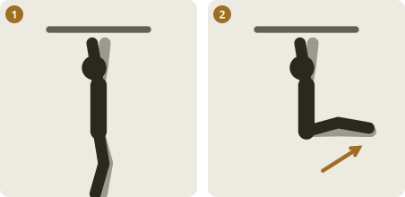

1. Hang from the bar, shoulders set, legs straight down
2. Lift the legs to hip height without swinging

### Oblique weighted arm dip

*Core · Strength* · Loads: shoulders.

Controlled reps, smooth up and down. Stop one or two reps before your form breaks.

### Sit-up to stand-up

*Core · Strength* · Loads: lower back.

Controlled reps, smooth up and down. Stop one or two reps before your form breaks.

### Wheelbarrow

*Core · Strength* · Loads: shoulders, wrists/forearms.

Controlled reps, smooth up and down. Stop one or two reps before your form breaks.

### Oblique knee raise plank

*Core · Strength* · Loads: shoulders, wrists/forearms.

Controlled reps, smooth up and down. Stop one or two reps before your form breaks.

### Farmer walk

*Full body · Strength* · Loads: fingers, wrists/forearms.

Controlled reps, smooth up and down. Stop one or two reps before your form breaks.

### A-frame drop

*Core · Strength* · Loads: shoulders, lower back.

Controlled reps, smooth up and down. Stop one or two reps before your form breaks.

### Plank (elevated)

*Core · Strength* · Loads: shoulders, wrists/forearms.

Controlled reps, smooth up and down. Stop one or two reps before your form breaks.

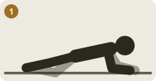

1. Forearms down, body one straight line from head to heels

### Plank (sideways walk)

*Core · Strength* · Loads: shoulders, wrists/forearms.

Controlled reps, smooth up and down. Stop one or two reps before your form breaks.

1. Forearms down, body one straight line from head to heels

### Side plank with leg raise

*Core · Strength* · Loads: shoulders, wrists/forearms.

Controlled reps, smooth up and down. Stop one or two reps before your form breaks.

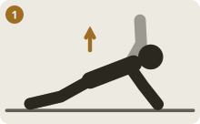

1. Elbow under shoulder, hips lifted in a straight line

### Full-body focus plank

*Core · Strength* · Loads: shoulders, wrists/forearms.

Controlled reps, smooth up and down. Stop one or two reps before your form breaks.

1. Forearms down, body one straight line from head to heels

### Kettlebell figure 8

*Core · Strength* · Loads: wrists/forearms, lower back.

Controlled reps, smooth up and down. Stop one or two reps before your form breaks.

### Matrix lean back

*Core · Strength* · Loads: lower back.

Controlled reps, smooth up and down. Stop one or two reps before your form breaks.

## Leg Day

### Squat/deadlift

*Legs · Strength* · Loads: knees, lower back.

Controlled reps, smooth up and down. Stop one or two reps before your form breaks.

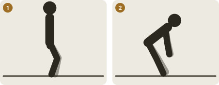

1. Stand tall, soft knees, ribs down
2. Push the hips back, flat back, hands slide down the thighs

### Catcher calf raises

*Calves/feet · Strength* · Loads: ankles/feet.

Controlled reps, smooth up and down. Stop one or two reps before your form breaks.

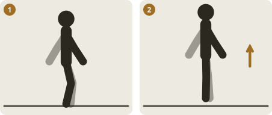

1. Stand tall, feet flat
2. Rise onto the toes, pause, lower slowly

### Calf jumps

*Calves/feet · Strength* · Loads: ankles/feet, knees.

Controlled reps, smooth up and down. Stop one or two reps before your form breaks.

1. Stand tall, feet flat
2. Rise onto the toes, pause, lower slowly

### High stepping

*Legs · Strength* · Loads: knees, ankles/feet.

Controlled reps, smooth up and down. Stop one or two reps before your form breaks.

### Weighted box jumps

*Legs · Strength* · Loads: knees, ankles/feet.

Controlled reps, smooth up and down. Stop one or two reps before your form breaks.

### Bulgarian lunges

*Legs · Strength* · Loads: knees, hips.

Controlled reps, smooth up and down. Stop one or two reps before your form breaks.

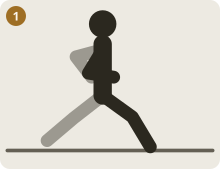

1. Long step, back knee drops straight down, torso tall

### Hanging knee lifts

*Core · Strength* · Loads: fingers, shoulders, elbows.

Controlled reps, smooth up and down. Stop one or two reps before your form breaks.

1. Hang from the bar, shoulders set, legs straight down
2. Lift the legs to hip height without swinging

### Wall sits

*Legs · Strength* · Loads: knees.

Controlled reps, smooth up and down. Stop one or two reps before your form breaks.

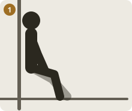

1. Back flat on the wall, thighs level, knees over the ankles

### Multidirectional lunges

*Legs · Strength* · Loads: knees, hips.

Controlled reps, smooth up and down. Stop one or two reps before your form breaks.

1. Long step, back knee drops straight down, torso tall

### Core-to-toe side lunges

*Legs · Strength* · Loads: knees, hips.

Controlled reps, smooth up and down. Stop one or two reps before your form breaks.

1. Long step, back knee drops straight down, torso tall

## Upper Tabata

### Bent-over rows

*Upper back · Strength* · Loads: lower back, elbows, upper back/neck.

Controlled reps, smooth up and down. Stop one or two reps before your form breaks.

### Lat pulldowns

*Upper back · Strength* · Loads: shoulders, elbows, upper back/neck.

Controlled reps, smooth up and down. Stop one or two reps before your form breaks.

### Bicep curls

*Elbows · Strength* · Loads: elbows.

Controlled reps, smooth up and down. Stop one or two reps before your form breaks.

### Wrist curls

*Wrists/forearms · Strength* · Loads: wrists/forearms, elbows.

Controlled reps, smooth up and down. Stop one or two reps before your form breaks.

## TRX — Core

### Body saw

*Core · Strength* · Loads: shoulders.

Controlled reps, smooth up and down. Stop one or two reps before your form breaks.

### Side plank with hip raise

*Core · Strength* · Loads: shoulders.

Controlled reps, smooth up and down. Stop one or two reps before your form breaks.

### Overhead squat

*Full body · Strength* · Loads: knees, shoulders.

Controlled reps, smooth up and down. Stop one or two reps before your form breaks.

## TRX — Shoulder

### Clock press

*Shoulders · Strength* · Loads: shoulders.

Controlled reps, smooth up and down. Stop one or two reps before your form breaks.

### T-Y-I deltoid series

*Shoulders · Prehab* · Loads: shoulders.

Light and slow: one set of 5 to 10 reps, well short of fatigue. This is for the joints, not a workout.

### Atomic pushups

*Core · Strength* · Loads: shoulders, wrists/forearms.

Controlled reps, smooth up and down. Stop one or two reps before your form breaks.

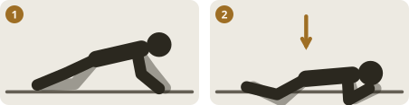

1. Hands under the shoulders, body one straight line
2. Lower with the elbows back until the chest is a fist from the floor

### T-spine rotation

*Upper back · Mobility* · Loads: upper back/neck.

Smooth, easy range. Move into it, do not force it.

## Full Efficient Workout

### Mountain mans (rope/pulley alternating lockouts)

*Full body · Strength* · Loads: fingers, shoulders, elbows.

Controlled reps, smooth up and down. Stop one or two reps before your form breaks.

### Campus board lunges

*Full body · Strength* · Loads: fingers, shoulders, elbows.

Controlled reps, smooth up and down. Stop one or two reps before your form breaks.

### Around-the-world pull-ups

*Full body · Strength* · Loads: fingers, shoulders, elbows.

Controlled reps, smooth up and down. Stop one or two reps before your form breaks.

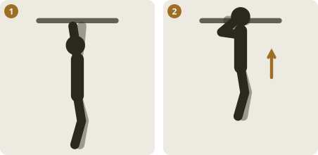

1. Hang from the bar with active shoulders, not sagging into them
2. Pull the elbows down until the chin clears the bar

### Offset pull-ups

*Full body · Strength* · Loads: fingers, shoulders, elbows.

Controlled reps, smooth up and down. Stop one or two reps before your form breaks.

1. Hang from the bar with active shoulders, not sagging into them
2. Pull the elbows down until the chin clears the bar

### Box jumps

*Legs · Strength* · Loads: knees.

Controlled reps, smooth up and down. Stop one or two reps before your form breaks.

### One-leg squats

*Legs · Strength* · Loads: knees.

Controlled reps, smooth up and down. Stop one or two reps before your form breaks.

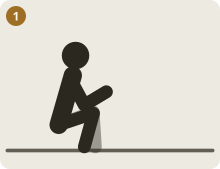

1. Feet shoulder-width, sit down with heels flat and chest tall

### Lunges with shoulder press

*Legs · Strength* · Loads: knees, shoulders.

Controlled reps, smooth up and down. Stop one or two reps before your form breaks.

### Step-ups onto box

*Legs · Strength* · Loads: knees.

Controlled reps, smooth up and down. Stop one or two reps before your form breaks.

### Tucks

*Core · Strength* · Loads: no specific joint region.

Controlled reps, smooth up and down. Stop one or two reps before your form breaks.

### Bridges

*Hips · Strength* · Loads: lower back, hips.

Controlled reps, smooth up and down. Stop one or two reps before your form breaks.

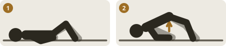

1. On your back, knees bent, feet flat
2. Drive the hips up until shoulders, hips and knees line up

### Side elbow planks

*Core · Strength* · Loads: shoulders.

Controlled reps, smooth up and down. Stop one or two reps before your form breaks.

1. Elbow under shoulder, hips lifted in a straight line

### Dip-bar leg raises

*Core · Strength* · Loads: shoulders, elbows.

Controlled reps, smooth up and down. Stop one or two reps before your form breaks.

1. Hang from the bar, shoulders set, legs straight down
2. Lift the legs to hip height without swinging

### Superman pushups

*Full body · Strength* · Loads: shoulders, wrists/forearms.

Controlled reps, smooth up and down. Stop one or two reps before your form breaks.

1. Hands under the shoulders, body one straight line
2. Lower with the elbows back until the chest is a fist from the floor

### Bicep/tricep work

*Elbows · Strength* · Loads: elbows.

Controlled reps, smooth up and down. Stop one or two reps before your form breaks.

### Chest/upper work

*Shoulders · Strength* · Loads: shoulders.

Controlled reps, smooth up and down. Stop one or two reps before your form breaks.

### Forearm plank

*Core · Strength* · Loads: shoulders.

Controlled reps, smooth up and down. Stop one or two reps before your form breaks.

1. Forearms down, body one straight line from head to heels

### Dolphin pushups

*Full body · Strength* · Loads: shoulders, wrists/forearms.

Controlled reps, smooth up and down. Stop one or two reps before your form breaks.

1. Hands under the shoulders, body one straight line
2. Lower with the elbows back until the chest is a fist from the floor

### One-arm planks

*Core · Strength* · Loads: shoulders, wrists/forearms.

Controlled reps, smooth up and down. Stop one or two reps before your form breaks.

### Toe touches

*Core · Strength* · Loads: lower back.

Controlled reps, smooth up and down. Stop one or two reps before your form breaks.

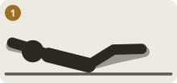

1. Low back pressed down, shoulders and legs just off the floor

### Scissor kicks

*Core · Strength* · Loads: lower back.

Controlled reps, smooth up and down. Stop one or two reps before your form breaks.

1. Low back pressed down, shoulders and legs just off the floor

## Yoga Poses

### Downward dog

*Shoulders · Stretch* · Loads: shoulders, wrists/forearms.

Hands and feet on the floor, hips high, heels reaching down. Press the chest toward the thighs.

### Child's pose

*Lower back · Stretch* · Loads: lower back.

Sit the hips back toward the heels and reach the arms long. Breathe into the back.

### Pigeon pose

*Hips · Stretch* · Loads: knees, hips.

Front shin across the mat, back leg long behind. Fold over the front leg and breathe.

### Warrior I

*Legs · Stretch* · Loads: knees.

Hold about 30 seconds each side, breathing slowly. Ease off if anything pinches.

### Warrior II

*Legs · Stretch* · Loads: knees.

Hold about 30 seconds each side, breathing slowly. Ease off if anything pinches.

### Triangle pose

*Legs · Stretch* · Loads: no specific joint region.

Hold about 30 seconds each side, breathing slowly. Ease off if anything pinches.

### Cat-cow

*Lower back · Mobility* · Loads: lower back.

On all fours, round the back, then arch it, moving with your breath.

### Cobra pose

*Lower back · Stretch* · Loads: lower back, wrists/forearms.

Hold about 30 seconds each side, breathing slowly. Ease off if anything pinches.

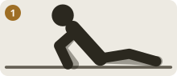

1. Hands under the shoulders, press the chest forward and up

### Seated forward fold

*Legs · Stretch* · Loads: lower back.

Hold about 30 seconds each side, breathing slowly. Ease off if anything pinches.

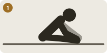

1. Legs long, hinge from the hips and reach toward the feet

### Low lunge

*Hips · Stretch* · Loads: knees, hips.

Hold about 30 seconds each side, breathing slowly. Ease off if anything pinches.

1. Long step, back knee drops straight down, torso tall

### Reclined spinal twist

*Lower back · Stretch* · Loads: lower back.

Hold about 30 seconds each side, breathing slowly. Ease off if anything pinches.

### Happy baby pose

*Hips · Stretch* · Loads: hips.

Hold about 30 seconds each side, breathing slowly. Ease off if anything pinches.

### Bridge pose

*Hips · Mobility* · Loads: hips.

Smooth, easy range. Move into it, do not force it.

1. On your back, knees bent, feet flat
2. Drive the hips up until shoulders, hips and knees line up

### Thread-the-needle

*Upper back · Stretch* · Loads: shoulders, upper back/neck.

On all fours, slide one arm under the other and rest the shoulder and ear on the floor. Rotate back out.

## Static Stretch

### Hip flexor stretch

*Hips · Stretch* · Loads: hips.

Hold about 30 seconds each side, breathing slowly. Ease off if anything pinches.

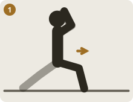

1. Back knee down, tuck the tailbone, reach up on the same side

### Hamstring stretch

*Legs · Stretch* · Loads: no specific joint region.

Hold about 30 seconds each side, breathing slowly. Ease off if anything pinches.

1. Legs long, hinge from the hips and reach toward the feet

### Adductor stretch

*Hips · Stretch* · Loads: hips.

Hold about 30 seconds each side, breathing slowly. Ease off if anything pinches.

### Rotator cuff stretch

*Shoulders · Stretch* · Loads: shoulders.

Hold about 30 seconds each side, breathing slowly. Ease off if anything pinches.

### Chest/biceps doorway stretch

*Shoulders · Stretch* · Loads: shoulders.

Hold about 30 seconds each side, breathing slowly. Ease off if anything pinches.

### Thoracic spine rotation

*Upper back · Mobility* · Loads: upper back/neck.

Smooth, easy range. Move into it, do not force it.

### Wrist mobility circles

*Wrists/forearms · Mobility* · Loads: wrists/forearms.

Fingers interlaced, make slow circles with both wrists in each direction.

### Shoulder dislocates (band/stick)

*Shoulders · Mobility* · Loads: shoulders.

Smooth, easy range. Move into it, do not force it.

### 90/90 hip switches

*Hips · Mobility* · Loads: knees, hips.

Sit with both knees bent at 90 degrees, then rotate both legs to the other side, keeping the torso tall.

### Standing quad stretch

*Legs · Stretch* · Loads: knees.

Hold about 30 seconds each side, breathing slowly. Ease off if anything pinches.

1. Legs long, hinge from the hips and reach toward the feet

### Calf stretch (wall)

*Calves/feet · Stretch* · Loads: no specific joint region.

Hold about 30 seconds each side, breathing slowly. Ease off if anything pinches.

### Couch stretch (hip flexor)

*Hips · Stretch* · Loads: knees, hips.

Back shin up the wall, front foot forward. Tuck the tailbone and stand tall.

1. Back knee down, tuck the tailbone, reach up on the same side

### Butterfly stretch

*Hips · Stretch* · Loads: hips.

Hold about 30 seconds each side, breathing slowly. Ease off if anything pinches.

### Lat stretch (overhead reach)

*Upper back · Stretch* · Loads: upper back/neck.

Hold about 30 seconds each side, breathing slowly. Ease off if anything pinches.

### Ankle dorsiflexion stretch

*Calves/feet · Stretch* · Loads: ankles/feet.

Hold about 30 seconds each side, breathing slowly. Ease off if anything pinches.

### Seated spinal twist

*Lower back · Stretch* · Loads: lower back.

Hold about 30 seconds each side, breathing slowly. Ease off if anything pinches.

### Neck rolls

*Upper back · Stretch* · Loads: upper back/neck.

Hold about 30 seconds each side, breathing slowly. Ease off if anything pinches.

### Frog stretch

*Hips · Stretch* · Loads: knees, hips.

Hold about 30 seconds each side, breathing slowly. Ease off if anything pinches.

## Foam Rolling

### Foam roll — IT band

*Legs · Release* · Loads: no specific joint region.

Roll or press slowly for 30 to 60 seconds on tender spots. Stay below sharp pain.

### Foam roll — quads

*Legs · Release* · Loads: no specific joint region.

Roll or press slowly for 30 to 60 seconds on tender spots. Stay below sharp pain.

### Foam roll — lats

*Upper back · Release* · Loads: upper back/neck.

Roll or press slowly for 30 to 60 seconds on tender spots. Stay below sharp pain.

### Foam roll — thoracic spine

*Upper back · Release* · Loads: upper back/neck.

Roll or press slowly for 30 to 60 seconds on tender spots. Stay below sharp pain.

### Foam roll — calves

*Calves/feet · Release* · Loads: no specific joint region.

Roll or press slowly for 30 to 60 seconds on tender spots. Stay below sharp pain.

### Foam roll — glutes

*Hips · Release* · Loads: hips.

Roll or press slowly for 30 to 60 seconds on tender spots. Stay below sharp pain.

### Foam roll — upper back

*Upper back · Release* · Loads: upper back/neck.

Roll or press slowly for 30 to 60 seconds on tender spots. Stay below sharp pain.

## Lacrosse Ball Release

### Lacrosse ball — glutes

*Hips · Release* · Loads: hips.

Roll or press slowly for 30 to 60 seconds on tender spots. Stay below sharp pain.

### Lacrosse ball — feet/plantar fascia

*Calves/feet · Release* · Loads: no specific joint region.

Roll or press slowly for 30 to 60 seconds on tender spots. Stay below sharp pain.

### Lacrosse ball — pecs

*Shoulders · Release* · Loads: shoulders.

Roll or press slowly for 30 to 60 seconds on tender spots. Stay below sharp pain.

### Lacrosse ball — forearms

*Wrists/forearms · Release* · Loads: wrists/forearms.

Roll or press slowly for 30 to 60 seconds on tender spots. Stay below sharp pain.

### Lacrosse ball — traps/upper back

*Upper back · Release* · Loads: upper back/neck.

Roll or press slowly for 30 to 60 seconds on tender spots. Stay below sharp pain.

## Functional Movement

### Squat-to-stand

*Legs · Mobility* · Loads: knees.

From a deep squat grab the toes, straighten the legs, then drop back down.

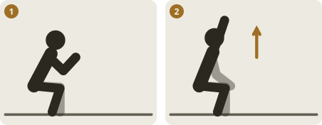

1. Sit down into a deep squat, hands together in front
2. Stay low, open the chest and reach one arm overhead

### Inchworm to plank

*Full body · Mobility* · Loads: wrists/forearms.

From standing, walk the hands out to a plank, then walk them back and stand up.

### Animal flow — bear crawl

*Full body · Mobility* · Loads: shoulders, wrists/forearms.

Knees an inch off the floor, crawl forward with opposite hand and foot together.

### Turkish get-up (bodyweight)

*Full body · Mobility* · Loads: shoulders, wrists/forearms.

Lying down, roll to the elbow, then hand, lift the hips, step back to a lunge and stand, eyes on the fist.

### Loaded carry (farmer/suitcase)

*Full body · Mobility* · Loads: fingers, wrists/forearms.

Smooth, easy range. Move into it, do not force it.

### Crawling patterns

*Full body · Mobility* · Loads: wrists/forearms.

Smooth, easy range. Move into it, do not force it.

### World's greatest stretch (full combo)

*Hips · Mobility* · Loads: hips.

Long lunge, hands inside the front foot, rotate and reach one arm up, then sit the hips back. Both sides.

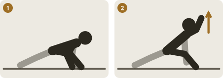

1. Long lunge, both hands down inside the front foot
2. Rotate open and reach one arm to the sky

### Windmills

*Lower back · Mobility* · Loads: lower back.

Smooth, easy range. Move into it, do not force it.

### Scorpion stretch

*Lower back · Mobility* · Loads: lower back.

Smooth, easy range. Move into it, do not force it.

## Body Prep

### Joint circles (ankles/hips/shoulders)

*Full body · Mobility* · Loads: no specific joint region.

Slow, full circles at each joint, a few each way. Just enough to feel it warm up.

### Arm circles

*Shoulders · Mobility* · Loads: shoulders.

Arms out, small circles growing to large, both directions.

### Leg swings (front-back)

*Hips · Mobility* · Loads: hips.

Hold something for balance and swing the leg freely forward and back, a little higher each swing.

### Leg swings (side-side)

*Hips · Mobility* · Loads: hips.

Hold something for balance and swing the leg across the body and out to the side.

### Hip circles

*Hips · Mobility* · Loads: hips.

Hands on hips, draw big slow circles with the pelvis, then reverse.

### Walking lunges with twist

*Legs · Mobility* · Loads: knees.

Smooth, easy range. Move into it, do not force it.

1. Long step, back knee drops straight down, torso tall

### High knees march

*Legs · Cardio* · Loads: no specific joint region.

March in place, driving the knees to hip height with an upright chest.

### Band pull-aparts

*Upper back · Prehab* · Loads: upper back/neck.

Arms straight in front, pull the band apart to chest level by squeezing the shoulder blades.

### Wall slides

*Shoulders · Prehab* · Loads: shoulders.

Forearms on the wall, slide them up as you stand tall, keeping the ribs down.

## Cardio Circuit

### Jump rope

*Full body · Cardio* · Loads: ankles/feet, knees.

A steady effort you could still talk through, with tidy form.

### Rowing intervals

*Full body · Cardio* · Loads: lower back.

A steady effort you could still talk through, with tidy form.

### Stair sprints

*Full body · Cardio* · Loads: knees.

A steady effort you could still talk through, with tidy form.

### Suicide sprints

*Full body · Cardio* · Loads: knees, ankles/feet.

A steady effort you could still talk through, with tidy form.

### Incline treadmill walk

*Full body · Cardio* · Loads: no specific joint region.

A steady effort you could still talk through, with tidy form.

### Bike intervals

*Full body · Cardio* · Loads: knees.

A steady effort you could still talk through, with tidy form.

### Burpees

*Full body · Cardio* · Loads: wrists/forearms, shoulders, knees.

A steady effort you could still talk through, with tidy form.

## Fingers

### Finger hangs

*Fingers · Fingers* · Loads: fingers, shoulders, elbows.

Warm up first. Hang from a comfortable edge with shoulders active and stop before the fingers fatigue.

### Finger pull-ups

*Fingers · Fingers* · Loads: fingers, shoulders, elbows.

Warm up first. Stop at any sharp pain in the fingers or elbows.

1. Hang from the bar with active shoulders, not sagging into them
2. Pull the elbows down until the chin clears the bar

### Finger planks

*Fingers · Fingers* · Loads: fingers, shoulders, elbows.

Warm up first. Stop at any sharp pain in the fingers or elbows.

### Hangboard repeaters

*Fingers · Fingers* · Loads: fingers, shoulders, elbows.

Warm up first. Stop at any sharp pain in the fingers or elbows.

### Minimum-edge hangs

*Fingers · Fingers* · Loads: fingers, shoulders, elbows.

Warm up first. Stop at any sharp pain in the fingers or elbows.

### Fingerboard moving hangs

*Fingers · Fingers* · Loads: fingers, shoulders, elbows.

Warm up first. Stop at any sharp pain in the fingers or elbows.

### HIT System (max-strength hangs)

*Fingers · Fingers* · Loads: fingers, shoulders, elbows.

Warm up first. Stop at any sharp pain in the fingers or elbows.

### Wrist curls (health/prehab)

*Wrists/forearms · Prehab* · Loads: wrists/forearms.

Light weight, forearm supported. Curl the wrist up and lower slowly, a few light reps.

### Finger extensions (rubber band)

*Fingers · Prehab* · Loads: fingers.

Band around the fingers and thumb. Open the hand against it slowly, then close slowly.

## Prehab

### Band external rotation

*Shoulders · Prehab* · Loads: shoulders.

Elbow pinned to your side at 90 degrees. Turn the forearm outward against the band, slowly, then return.

### Scapular push-ups

*Shoulders · Prehab* · Loads: wrists/forearms, shoulders.

In a plank with straight arms, let the chest sink between the shoulder blades, then push them apart. Only the shoulder blades move.

### Prone Y raises

*Upper back · Prehab* · Loads: upper back/neck.

Face down, thumbs up, lift the arms in a Y by squeezing between the shoulder blades. Do not arch the back.

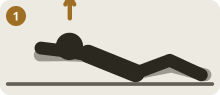

1. Face down, arms long. Lift the chest and arms, squeeze the shoulder blades

### Prone T raises

*Upper back · Prehab* · Loads: upper back/neck.

Face down, arms out to the sides like a T, lift by squeezing the shoulder blades together.

1. Face down, arms long. Lift the chest and arms, squeeze the shoulder blades

### Wall angels

*Shoulders · Prehab* · Loads: shoulders.

Back, hips and forearms on the wall. Slide the arms up and down, keeping contact the whole way.

### Face pulls (band)

*Upper back · Prehab* · Loads: upper back/neck.

Pull the band toward the face with the elbows high and wide, finishing with the hands beside the ears.

### Reverse wrist curls

*Wrists/forearms · Prehab* · Loads: wrists/forearms.

Forearm on a thigh, palm down. Lift the back of the hand slowly and lower it slowly, with a light weight.

### Wrist pronation-supination (light weight)

*Wrists/forearms · Prehab* · Loads: wrists/forearms.

Elbow at your side, hold a light weight. Rotate the palm up, then down, slowly.

### Radial-ulnar deviation (light weight)

*Wrists/forearms · Prehab* · Loads: wrists/forearms.

Forearm supported, hold a light weight. Tilt the hand toward the thumb side, then the little-finger side.

### Band wrist extensions

*Wrists/forearms · Prehab* · Loads: wrists/forearms.

Forearm supported, palm down, band around the hand. Lift the hand against the band slowly.

### Eccentric wrist extensions (slow lower)

*Elbows · Prehab* · Loads: wrists/forearms, elbows.

Lift the hand up with the other hand, then lower it to the count of five on your own.

### Band triceps extensions

*Elbows · Prehab* · Loads: elbows.

Elbows tucked, straighten the arms against the band, then return slowly.

### Prone cobra

*Upper back · Prehab* · Loads: lower back, upper back/neck.

Face down, lift the chest and arms a few inches and squeeze the shoulder blades. Hold a moment.

1. Face down, arms long. Lift the chest and arms, squeeze the shoulder blades

### Clamshells

*Hips · Prehab* · Loads: hips.

On your side, knees bent, feet together. Open the top knee without rolling the pelvis back.

### Banded lateral walks

*Hips · Prehab* · Loads: knees, hips.

Band above the knees, small knee bend. Step sideways with control, keeping the toes forward.

### Glute bridges

*Hips · Prehab* · Loads: lower back, hips.

On your back, feet flat. Drive the hips up until shoulders, hips and knees line up, then lower slowly.

1. On your back, knees bent, feet flat
2. Drive the hips up until shoulders, hips and knees line up

### Fire hydrants

*Hips · Prehab* · Loads: hips.

On all fours, lift one knee out to the side without twisting the trunk, then lower.

### Bird dog

*Core · Prehab* · Loads: wrists/forearms.

On all fours, reach one arm forward and the opposite leg back, keeping the hips level.

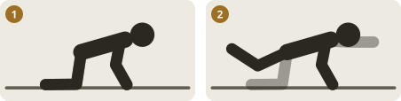

1. On hands and knees, back flat
2. Reach one arm forward and the opposite leg back

### Dead bug

*Core · Prehab* · Loads: no specific joint region.

On your back, arms up and knees over the hips. Lower the opposite arm and leg while the low back stays flat.

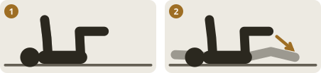

1. On your back, arms up, knees over hips
2. Lower the opposite arm and leg together, back flat

### Terminal knee extensions (band)

*Legs · Prehab* · Loads: knees.

Band behind the knee, slight bend. Straighten the knee fully against the band and squeeze the thigh.

### Tibialis raises

*Calves/feet · Prehab* · Loads: no specific joint region.

Heels on the floor, back against a wall. Lift the toes toward the shins, then lower.

### Short-foot exercise

*Calves/feet · Prehab* · Loads: no specific joint region.

Without curling the toes, draw the ball of the foot toward the heel to lift the arch.

### Single-leg balance

*Calves/feet · Prehab* · Loads: no specific joint region.

Stand on one leg, eyes on a fixed point. Keep the hips level and the knee soft.

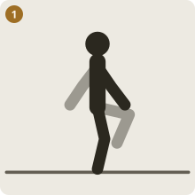

1. Stand tall on one leg, hands on hips, eyes on a spot (then closed)

## General/Other

### Hanging leg raises

*Core · Strength* · Loads: fingers, shoulders, elbows.

Hang from the bar and lift the legs to hip height without swinging, then lower with control.

1. Hang from the bar, shoulders set, legs straight down
2. Lift the legs to hip height without swinging

### Pistol squats

*Legs · Strength* · Loads: knees.

Controlled reps, smooth up and down. Stop one or two reps before your form breaks.

1. Feet shoulder-width, sit down with heels flat and chest tall

### Raised-leg diamond pushups

*Full body · Strength* · Loads: shoulders, wrists/forearms, elbows.

Controlled reps, smooth up and down. Stop one or two reps before your form breaks.

1. Hands under the shoulders, body one straight line
2. Lower with the elbows back until the chest is a fist from the floor

### Jumping lunges

*Legs · Strength* · Loads: knees.

Controlled reps, smooth up and down. Stop one or two reps before your form breaks.

1. Long step, back knee drops straight down, torso tall

### Lateral pull-ups

*Upper back · Strength* · Loads: fingers, shoulders, elbows, upper back/neck.

Controlled reps, smooth up and down. Stop one or two reps before your form breaks.

1. Hang from the bar with active shoulders, not sagging into them
2. Pull the elbows down until the chin clears the bar

### Upside-down shoulder press

*Shoulders · Strength* · Loads: shoulders, wrists/forearms.

Controlled reps, smooth up and down. Stop one or two reps before your form breaks.

### Tricep dips

*Elbows · Strength* · Loads: shoulders, elbows, wrists/forearms.

Controlled reps, smooth up and down. Stop one or two reps before your form breaks.

### Incline pushups

*Shoulders · Strength* · Loads: shoulders, wrists/forearms.

Controlled reps, smooth up and down. Stop one or two reps before your form breaks.

1. Hands under the shoulders, body one straight line
2. Lower with the elbows back until the chest is a fist from the floor

### Chair ups

*Legs · Strength* · Loads: knees.

Controlled reps, smooth up and down. Stop one or two reps before your form breaks.

1. Feet shoulder-width, sit down with heels flat and chest tall

### Stair jumps

*Legs · Strength* · Loads: knees, ankles/feet.

Controlled reps, smooth up and down. Stop one or two reps before your form breaks.

### Front squats

*Legs · Strength* · Loads: knees, wrists/forearms, lower back.

Controlled reps, smooth up and down. Stop one or two reps before your form breaks.

1. Feet shoulder-width, sit down with heels flat and chest tall

### Turkish getup

*Full body · Strength* · Loads: shoulders, wrists/forearms.

Controlled reps, smooth up and down. Stop one or two reps before your form breaks.

### Straight-arm planks

*Core · Strength* · Loads: shoulders, wrists/forearms.

Controlled reps, smooth up and down. Stop one or two reps before your form breaks.

### Shoulder dislocates

*Full body · Strength* · Loads: no specific joint region.

Controlled reps, smooth up and down. Stop one or two reps before your form breaks.

## Still to illustrate

117 exercises have no drawn steps yet:

- Oblique weighted arm dip
- Sit-up to stand-up
- Wheelbarrow
- Oblique knee raise plank
- Farmer walk
- A-frame drop
- Kettlebell figure 8
- Matrix lean back
- High stepping
- Weighted box jumps
- Bent-over rows
- Lat pulldowns
- Bicep curls
- Wrist curls
- Body saw
- Side plank with hip raise
- Overhead squat
- Clock press
- T-Y-I deltoid series
- T-spine rotation
- Mountain mans (rope/pulley alternating lockouts)
- Campus board lunges
- Box jumps
- Lunges with shoulder press
- Step-ups onto box
- Tucks
- Bicep/tricep work
- Chest/upper work
- One-arm planks
- Downward dog
- Child's pose
- Pigeon pose
- Warrior I
- Warrior II
- Triangle pose
- Cat-cow
- Reclined spinal twist
- Happy baby pose
- Thread-the-needle
- Adductor stretch
- Rotator cuff stretch
- Chest/biceps doorway stretch
- Thoracic spine rotation
- Wrist mobility circles
- Shoulder dislocates (band/stick)
- 90/90 hip switches
- Calf stretch (wall)
- Butterfly stretch
- Lat stretch (overhead reach)
- Ankle dorsiflexion stretch
- Seated spinal twist
- Neck rolls
- Frog stretch
- Foam roll — IT band
- Foam roll — quads
- Foam roll — lats
- Foam roll — thoracic spine
- Foam roll — calves
- Foam roll — glutes
- Foam roll — upper back
- Lacrosse ball — glutes
- Lacrosse ball — feet/plantar fascia
- Lacrosse ball — pecs
- Lacrosse ball — forearms
- Lacrosse ball — traps/upper back
- Inchworm to plank
- Animal flow — bear crawl
- Turkish get-up (bodyweight)
- Loaded carry (farmer/suitcase)
- Crawling patterns
- Windmills
- Scorpion stretch
- Joint circles (ankles/hips/shoulders)
- Arm circles
- Leg swings (front-back)
- Leg swings (side-side)
- Hip circles
- High knees march
- Band pull-aparts
- Wall slides
- Jump rope
- Rowing intervals
- Stair sprints
- Suicide sprints
- Incline treadmill walk
- Bike intervals
- Burpees
- Finger hangs
- Finger planks
- Hangboard repeaters
- Minimum-edge hangs
- Fingerboard moving hangs
- HIT System (max-strength hangs)
- Wrist curls (health/prehab)
- Finger extensions (rubber band)
- Band external rotation
- Scapular push-ups
- Wall angels
- Face pulls (band)
- Reverse wrist curls
- Wrist pronation-supination (light weight)
- Radial-ulnar deviation (light weight)
- Band wrist extensions
- Eccentric wrist extensions (slow lower)
- Band triceps extensions
- Clamshells
- Banded lateral walks
- Fire hydrants
- Terminal knee extensions (band)
- Tibialis raises
- Short-foot exercise
- Upside-down shoulder press
- Tricep dips
- Stair jumps
- Turkish getup
- Straight-arm planks
- Shoulder dislocates
